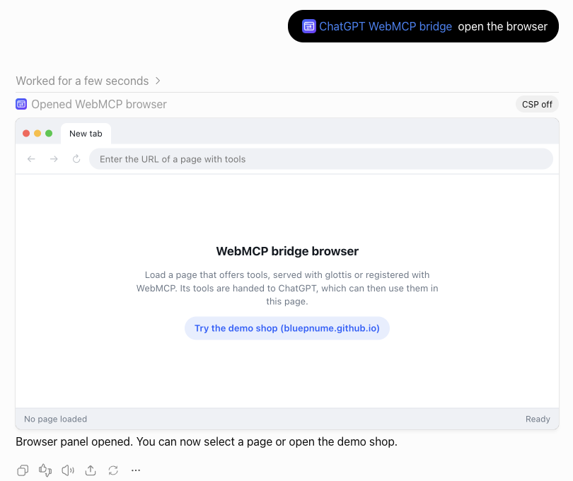
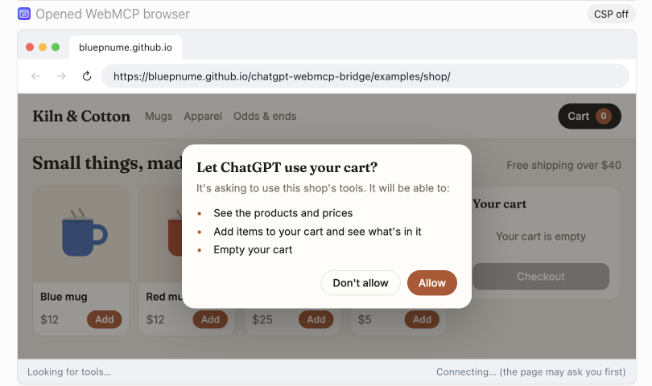
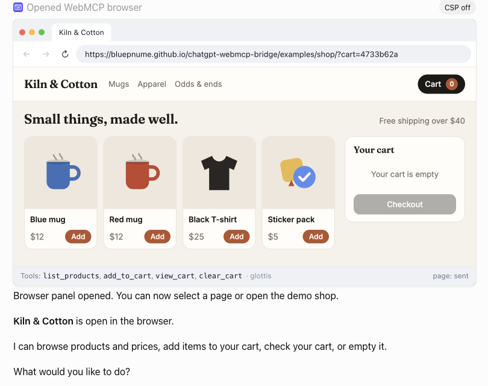
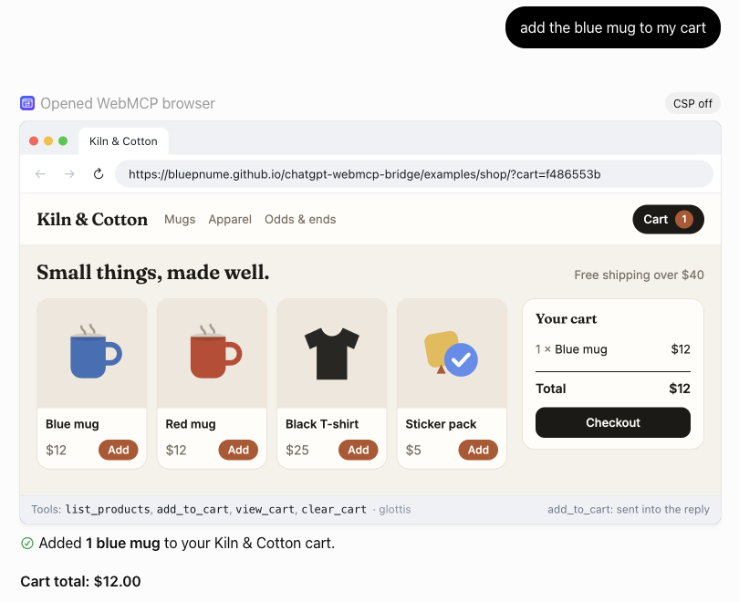

# chatgpt-webmcp-bridge

A ChatGPT plugin that lets ChatGPT use a web page's tools.

It opens a small browser inside the chat. Load a page that offers tools, and ChatGPT can see them and use them: the page runs each call in your own browser, and the result comes back into the conversation.

A page offers tools in one of two ways:

- **With [glottis](https://github.com/bluepnume/glottis).** Works in every browser, today.
- **With [WebMCP](https://github.com/webmachinelearning/webmcp)**, the draft browser API for tools. Works in Chrome with WebMCP switched on, for testing.

```
You: "add the blue mug to my cart"
  → ChatGPT calls the plugin
  → the panel in the chat runs add_to_cart on the shop page, in your browser
  → "✓ add_to_cart ran on Kiln & Cotton" comes back, and ChatGPT tells you
```

## What it looks like

Open the browser, and it offers the demo shop:



Click it, and the shop asks before it lets ChatGPT in. The question comes from the page itself, so only your click can answer it:



Allow it, and ChatGPT says what it can do there. The status bar lists the page's tools, and the route they came by:



Ask for something, and ChatGPT calls the page's tool. The page runs it, and the result comes back into the chat:



## Try it in three minutes

You need ChatGPT with developer mode, which lets you add MCP servers that are not in ChatGPT's app directory (see OpenAI's [Apps SDK guide](https://developers.openai.com/apps-sdk)).

1. In ChatGPT, open **Plugins › Add › Add custom MCP server**.
2. Fill it in:
   - **Icon:** [`assets/icon-256.png`](assets/icon-256.png) (optional)
   - **Name:** `ChatGPT WebMCP bridge`
   - **Server URL:** `https://webmcp.danielbrain.ai/chatgpt-webmcp-bridge/mcp`
   - **Authentication:** No authentication
3. Start a chat, type `@ChatGPT WebMCP bridge open the browser`, then click **Try the demo shop**.
4. Click **Allow** in the shop, then ask: *add the blue mug to my cart*.

That server is a best-effort demo instance. To run your own, see [Run your own server](docs/4-run-your-own-server.md).

## Pick your route

| You want to | Read |
| --- | --- |
| Try the plugin | [1. Try it](docs/1-try-it.md) |
| Let ChatGPT use your own page | [2. Your page with glottis](docs/2-your-page-with-glottis.md) |
| Test a page that uses WebMCP directly | [3. True WebMCP mode](docs/3-true-webmcp-mode.md) |
| Host the server yourself | [4. Run your own server](docs/4-run-your-own-server.md) |
| Give your ChatGPT connection an icon, prompts and description | [5. The ChatGPT connection and plugin ZIP](docs/5-chatgpt-connection.md) |
| Understand what happens, step by step | [6. How it works](docs/6-how-it-works.md) |
| Fix something | [7. Troubleshooting](docs/7-troubleshooting.md) |
| Look up an option or a message | [8. Reference](docs/8-reference.md) |

## How it works, in one paragraph

ChatGPT runs plugin UIs in sandboxed frames. This plugin's frame, the **panel**, is a small browser that loads your page in a frame of its own. The panel connects to the page with glottis (or native WebMCP), reads its tools and hands them to ChatGPT. When ChatGPT calls a tool, the plugin's MCP server only hands out a call id; ChatGPT opens a new panel for the call, which runs the tool in the page and posts the result into the conversation. The server never sees your page or its results. More in [How it works](docs/6-how-it-works.md).

## Status

Experimental, and version 0.x: things will change.

- **Developer mode only.** ChatGPT's app directory does not accept apps that embed other pages, which is this plugin's whole job.
- **The panel only shows pages it was set up for.** ChatGPT lets a plugin frame only the origins it lists, exactly, with no wildcards. The demo instance lists only the demo shop; to use your own page, run your own server with your page's origin added (see [4. Run your own server](docs/4-run-your-own-server.md)).
- **Native WebMCP needs a workaround.** ChatGPT does not give its plugin frames the `tools` permission, so true WebMCP mode needs the launcher in [3. True WebMCP mode](docs/3-true-webmcp-mode.md).

## License

MIT
